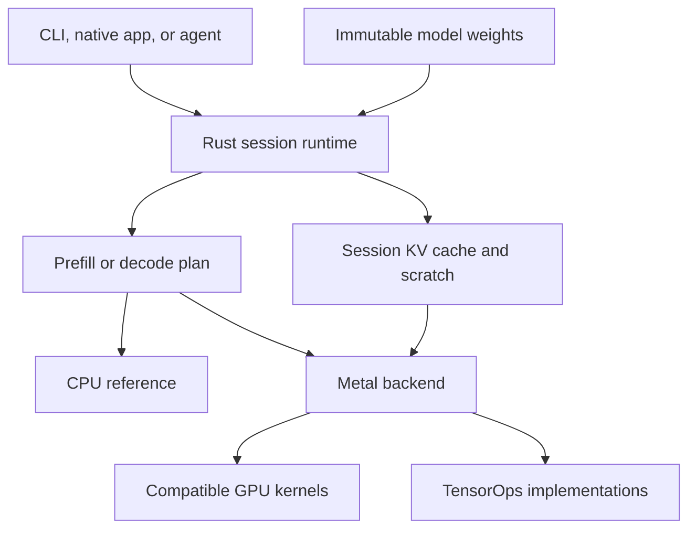

# Apple LLM Engine Performance Plan

**Prepared:** 7 October 2026

**Primary target:** Mac M1 Pro with 16 GB unified memory

**Later targets:** iPhone 14, iPad, and newer Apple Silicon Macs

**Engine language:** Rust; Python for numerical references and conversion; Swift for native integration

**Status:** Planning proposal. No engine implementation or Apple-device benchmark is claimed here.

## 1. Recommended direction

Build a small inference engine whose model execution, memory ownership, and scheduling you understand. Keep the CPU-first educational milestone from the existing PLAN.md. Preserve its explicit CPU + Neural Engine evaluation. For the performance version, bring native Metal work forward after correctness and a bounded ANE feasibility experiment.

The intended progression is:

1. Correct tiny Rust CPU decoder.
2. Correct pretrained Qwen decoder with persistent KV state.
3. Reproducible measurements and a short public CPU/ANE experiment.
4. Complete Metal execution.
5. Separate optimized decode and prefill paths.
6. One well-understood weight quantization, then long-context attention.
7. Physical iPhone validation.
8. Workload-specific research: Gemma, speculation, branching, and newer GPU features.

This is an explicit proposed change to the earlier sequence, which placed GPU work after application milestones. The initial numerical runtime remains CPU-only. External GPU benchmarks are development comparisons, and the ANE experiment reports actual placement. Existing implementation tickets are not marked complete by this document.

The technical thesis is reduced memory traffic, persistent state, efficient GPU kernels, and low scheduling overhead. Rust is the implementation language; choosing Rust alone is not a performance result.

## 2. Define the performance target

The first target should be **one local interactive session on the M1 Pro, at a fixed model quality and a bounded memory footprint**. Once that works, qualify the iPhone separately.

| Metric | What it answers |
|---|---|
| Cold readiness | How long do loading, conversion, and compilation take before the first usable request? |
| Warm time to first token | How quickly does an already-loaded model start responding? |
| Prefill throughput | How quickly does the engine process new prompt tokens? |
| Decode latency | How long does each subsequent token take at a specified context depth? |
| Continuation latency | How quickly does generation resume after a tool result or another user turn? |
| Peak footprint | Do weights, KV state, scratch, and application overhead fit without severe memory pressure? |
| Sustained speed and energy | Does useful performance persist after the device warms up? |
| Quality | Does a faster precision or cache configuration preserve the required behavior? |

Optimize these subject to a quality floor chosen before evaluating lossy changes. First reach parity with the strongest measured baseline on a named workload, then establish a repeatable improvement beyond measurement noise. A faster model, smaller context, or different quantization is an application tradeoff and must be labeled.

Use two comparison tracks:

- **Controlled engine comparison:** identical checkpoint revision, token IDs, compatible numerical representation, cache semantics, and output length.
- **Application comparison:** each runtime uses its practical configuration, but all must pass the same quality and memory criteria. Native quantization differences are recorded.

## 3. Understand where the time goes

### 3.1 Prefill and decode need different implementations

During ordinary single-session decode, each projection applies a weight matrix to one token vector. During prefill, many prompt-token vectors can be processed together, reusing the same weights. Apple's GPU guidance describes this change in arithmetic intensity and why matrix shape changes the bottleneck.[^apple-gpu]

Let m mean the number of token rows processed together, not necessarily the number of users:

- Decode for one session: m = 1.
- Prefill for one session: m = prompt chunk length.
- Batched decode: m = number of active sequences.

For P matrix weights stored at q bits, a simplified weight-only arithmetic intensity is:

    arithmetic intensity ≈ 2 × P × m / (P × q / 8)
                         = 16 × m / q FLOP per byte

This is a derivation that omits metadata, activations, and attention traffic. At four bits it gives about 4 × m FLOP/byte. Larger prefill chunks increase weight reuse, while adding workspace and potentially different attention costs.

Consequently, build a matrix-vector decode path and a matrix-matrix prefill path. Profile the actual shapes: short prefill can still be limited by dispatch or memory, and long-context attention can dominate either phase.

### 3.2 A bandwidth estimate for the M1 Pro

Apple specifies 200 GB/s memory bandwidth for M1 Pro.[^m1] Consider an illustrative dense workload that streams approximately seven billion weights per ordinary generated token:

    Ideal Q4 payload = 7,000,000,000 × 0.5 bytes
                     = 3.5 GB
    Weight-only optimistic ceiling = 200 / 3.5
                                   ≈ 57 tokens/s

A format also needs metadata. For example, affine Q4 with one FP16 scale and one FP16 bias per group of 64 uses:

    bytes per weight = 0.5 + (2 + 2) / 64 = 0.5625
    Approximate weight payload = 3.94 GB
    Weight-only optimistic ceiling ≈ 51 tokens/s

MLX documents this kind of grouped affine quantization.[^mlx-quant] These figures are calculated illustrations, not measured performance or forecasts. Attainable bandwidth is lower than a theoretical peak; KV reads, dequantization, other traffic, and dispatch add costs. The amount streamed also depends on architecture and caching.

A useful approximate lower bound is:

    token time ≳ max(
        operations per step / attainable compute throughput,
        bytes transferred per step / attainable memory bandwidth
    )

Compute and memory activity may overlap, so their isolated times should not automatically be added. Batching or speculative verification can amortize weight reads across multiple output tokens and exceed the ordinary one-token estimate.

### 3.3 Unified memory still needs careful ownership

CPU and GPU can use the same physical memory pool, but dependent operations must be ordered.[^unified] Design for persistent weights and state, explicit buffer lifetimes, and deliberate synchronization.

The first Metal implementation should use straightforward owned buffers. Later compare shared and GPU-private storage for the actual access pattern. Validate any attempt to adopt a file mapping directly as a GPU buffer; unified memory alone does not establish that it is compatible.

Avoid keeping redundant full CPU and GPU weight copies in performance mode. Preserve the readable CPU implementation in code and fixtures without requiring a second live FP32 model allocation.

## 4. Choose the Apple execution paths

| Path | Role in this project | Selection rule |
|---|---|---|
| Rust scalar CPU | Learning and numerical oracle | Always available for tiny tests and diagnostics |
| Selected CPU optimizations | A bounded learning step and useful fallback | Retain only measured improvements |
| Classic Metal kernels | Broad GPU execution path | Required for qualified older devices and OS versions |
| Metal TensorOps | Candidate matrix operations and fused kernels | Select by API availability, device capabilities, and measured shape performance |
| Core ML CPU + ANE | Public ANE feasibility experiment | Use a compute policy that excludes GPU; inspect actual placement |
| Core AI | Optional contemporary deployment experiment | Qualify independently on supported OS versions |

Apple documents TensorOps across M1 through M5, with shader implementations on older GPUs and dedicated GPU Neural Accelerators on newer hardware. Those GPU accelerators are distinct from the separate Apple Neural Engine.[^apple-gpu] The OS27 Metal additions include more quantized tensor formats and scale planes.[^metal26]

Evaluate TensorOps or an existing Apple matrix primitive before committing to a large custom GEMM implementation. The engine can still own model execution, buffer layout, KV state, scheduling, and fusion. Keep compatibility kernels when the newer API is unavailable or slower.

For new Rust Metal bindings, use a small backend boundary around objc2 and objc2-metal. The metal-rs maintainers explicitly recommend those replacements for new development.[^metal-rs] Check the exact SDK coverage when the Metal milestone begins.

### CPU and ANE feasibility experiment

Limit the initial experiment to 12–20 focused hours including the bounded CPU optimization:

1. Establish one CPU improvement from a profile, without turning this into a general CPU math library.
2. Convert the tiny decoder or a supported slice through a public deployment route.
3. Compare the CPU-only policy with Core ML's CPU-and-Neural-Engine policy, which excludes GPU.[^cpu-ne]
4. If conversion succeeds, preserve state and compare outputs, placement, latency, and memory.
5. Record the result as useful, uncompetitive, unsupported, or requiring further research.

Core ML has stateful model support for persistent intermediate buffers, including KV caches, starting with iOS18/macOS15.[^stateful] Core AI, introduced at WWDC26, also exposes stateful execution and custom Metal integration; its current debugger and attached-device execution workflow requires OS27.[^core-ai][^core-ai-debugger]

A successful conversion does not establish ANE execution. A supported projection or decoder slice establishes only that component's feasibility. Selecting ANE for the complete engine requires an end-to-end stateful decode measurement, including CPU fallback, transfers, and actual placement. Failure to qualify this path within the experiment should become a documented result, not an open-ended obstacle to the GPU performance work.

## 5. Keep the architecture small

Start with one Rust package. Add modules when their implementation exists; split crates only when dependency or build boundaries justify it.

| Module | Owns |
|---|---|
| model | One validated architecture, immutable weights, and forward-pass order |
| weights | Checkpoint parsing, dtype conversion, shape validation, and packing metadata |
| cpu | Readable numerical operations |
| metal | Device buffers, pipelines, GPU kernels, and command submission |
| session | Token history, committed cache positions, KV buffers, and reusable scratch |
| sampling | Greedy generation, then reproducible stochastic policies |
| generation | Bounded token streaming, stop rules, cancellation, and statistics |
| bench | Fixed workloads, timing boundaries, quality checks, and result records |

The destination architecture is:

The diagram describes responsibilities, not packages to scaffold immediately. The first CPU operation needs ordinary functions over slices. Introduce a narrow backend interface only once both CPU and GPU execution show which operations it must represent.

The eventual session API should allow loading a supported model, creating a bounded session, appending token IDs, generating a bounded token stream, cancellation, reset, and memory/timing statistics.

Keep full logits and intermediate tensors internal. Initial CPU sampling is fine, but the public interface should also allow GPU sampling that returns only a token ID. Otherwise the interface can force a large readback every step.

Chat formatting, Hugging Face search, downloads, UI, and tool execution belong outside numerical model execution. Add a Swift bridge when the native app needs it; design the stable binary boundary then.

## 6. Model and artifact strategy

### Learning model

Reuse the existing tiny two-layer specification:

| Dimension | Value |
|---|---:|
| Vocabulary | 64 |
| Layers | 2 |
| Hidden size | 32 |
| Query heads | 4 |
| KV heads | 2 |
| Head dimension | 8 |
| Feed-forward size | 64 |
| Initial context capacity | 32 |

Use fixed fixtures read by Rust and an independent Python reference. A shared seed across different random-number generators is insufficient to guarantee identical weights.

### First pretrained model

Continue with Qwen/Qwen2.5-0.5B-Instruct. Its configuration declares BF16, 24 layers, 14 query heads, two KV heads, and tied embeddings.[^qwen] Inspect actual tensor dtypes during import and convert explicitly into FP32 for the CPU milestone. Verify biases, rotary convention, normalization epsilon, masking, tokenizer/template behavior, and shared embedding/output storage against the pinned reference.

Start with short prompts, batch one, and no padding. Increase to 2,048 total tokens, including output, after cached correctness and memory checks.

Then choose one larger checkpoint in the implemented family to study realistic memory-bound decoding. A tiny model is useful for correctness but may emphasize host overhead differently from a larger model.

### Gemma specialization

Treat the later Gemma 4 coding-agent target as its own architecture milestone. The current model card describes hybrid local/global attention, and E2B's effective parameter label differs from its total stored parameters: the card lists 5.1B with embeddings.[^gemma] Parse the chosen variant's actual config and tensors. Do not size its memory from “E2B,” or apply the simple uniform KV formula without adapting it to layer types and sharing.

### File formats

Use one transparent import pipeline first: pinned source checkpoint, safetensors tensors, config, and tokenizer assets. Reuse their parsers.

For quantization, specify the bit packing, group size, scale convention, tensor exclusions, alignment, and version. A safetensors container does not define the model computation or make MLX quantized tensors automatically compatible. Implement the exact selected schema; test reconstructed weights against its reference.

Keep source identity distinct from a derived packed representation. Any persistent packed-weight cache should include the source hash, packing version, quantization identity, and relevant backend properties.

GGUF import is a separate later capability. The model browser should eventually report verified execution compatibility for an exact artifact, rather than treating every MLX search result as runnable.

## 7. Optimization sequence

### 7.1 Keep useful state resident

Load weights once. Retain the session KV cache between turns and tool results. Preallocate scratch for admitted shapes. Store pipeline objects and other reusable command resources across tokens.

When a new prompt arrives, identify the exact shared token prefix and reuse only state that is still valid. A text match later in a changed conversation is insufficient. Include model and position semantics in validity checks.

A rotating or sliding-window cache can discard state needed to rewind to an earlier prefix. Reuse only a representable state; otherwise replay from a suitable checkpoint or token history.

Track generated tokens separately from tokens already evaluated into K/V. The last sampled token may not have passed through the model yet. Cancellation must leave a valid committed state or trigger explicit invalidation and replay.

If the entire prompt is already evaluated and there is no pending token or uncached suffix, retain its final hidden state/logits, or rewind and replay the last token. KV alone does not supply the next-token distribution. A restorable stochastic generation state also needs its sampling state when exact continuation is required.

### 7.2 Get complete FP16 Metal execution working

Use FP16 weights/activations where numerically qualified and suitable accumulation for reductions. Implement the full supported forward pass before diagnosing overall GPU performance.

Begin with embedding, linear projections, normalization, rotary positions, attention, gated MLP, residuals, output projection, and sampling. A host wait after each operator is acceptable during initial debugging but must not become the optimized scheduling design.

Run a GPU trace. Distinguish a slow kernel from idle gaps caused by CPU encoding, allocation, or synchronization. Reading one selected token is much cheaper than exposing every intermediate result to the host.

### 7.3 Add one weight quantization

A practical first candidate is grouped affine Q4 with FP16 activations, checked against a simple CPU dequantization oracle. Q8 can be a bounded intermediate exercise if it helps establish the packing contract.

The important implementation is fused dequantization plus matrix-vector multiplication: read packed weights, reconstruct values in registers or on-chip tiles, accumulate, and write the result. Avoid expanding the entire model into FP16 before every step.

Document which tensors remain at higher precision. Compare loss and task behavior as well as speed. Quantization is accepted only after its quality gate.

### 7.4 Optimize prefill separately

Use tiled matrix-matrix operations and reuse dequantized weight tiles across prompt rows. Tune a small grid of prompt chunk sizes, such as 128, 256, 512, and 1,024, within the memory budget.

When only the final prompt position's logits are required, avoid materializing vocabulary logits for every prompt token. Keep the diagnostic path that exposes selected intermediate values outside timed execution.

Use TensorOps when qualified, and measure alternative kernels at the actual model dimensions. A tile optimized for one square matrix is not evidence for the projection shapes in the model.

### 7.5 Fuse measured sources of extra traffic

Candidates include residual addition with normalization, rotary transformation with cache writes, and MLP activation/gating epilogues. Combine Q/K/V projection dispatch where their layout and measured behavior make that useful.

Fusion can increase register pressure, reduce occupancy, or duplicate work. Keep each change only if it improves the full workload and remains understandable.

### 7.6 Tune scheduling and sampling

Encode dependent work without a host synchronization after every layer. Preserve required resource dependencies and completion boundaries. Cache compiled pipelines and consider command/argument reuse when supported and useful.

Move greedy selection or a measured sampling bottleneck to the GPU. The resulting host boundary should usually carry a token ID and small statistics. Account for penalties and filtering in any stochastic path.

Specialize for a short list of real shapes and device capability groups. Prefer a small measured dispatch table to an early general autotuning compiler.

## 8. Long-context memory and attention

For conventional full-attention layers with equal key/value head dimensions, the logical KV payload for one sequence is:

    KV bytes = 2 × layers × cached tokens × KV heads
               × head dimension × bytes per element

As a calculated example, take 32 layers, eight KV heads, head dimension 128, and FP16:

    KV bytes per token = 2 × 32 × 8 × 128 × 2
                       = 131,072 bytes = 128 KiB

| Cached tokens | Logical KV payload |
|---:|---:|
| 4,096 | 0.5 GiB |
| 8,192 | 1 GiB |
| 16,384 | 2 GiB |
| 32,768 | 4 GiB |
| 65,536 | 8 GiB |

This is an illustrative full-attention architecture, not the Qwen or Gemma configuration. Include padding, metadata, and working buffers in actual admission accounting. For the first Qwen checkpoint, the same formula gives 48 MiB at 2,048 positions in FP32, or 24 MiB in FP16.

Full-attention decode also reads prior K/V. At long context, that traffic can compete with weight traffic. Reducing weight precision alone does not solve the resulting latency.

Start with separate per-layer K and V storage, logically [KV head, token capacity, head dimension], with the head dimension contiguous. Preserve grouped-query sharing in the kernel; do not physically replicate KV heads.

Allocate bounded capacity or grow in coarse increments. Updating the new slice avoids the repeated cache copying and allocator overhead described in MLX's cache guide.[^kv-guide]

Next add:

1. Tiled attention with online softmax, separately qualified for prefill and decode.
2. Chunked prefill that obeys the causal boundary at every absolute position.
3. Context-depth profiling and shape-specific attention tuning.
4. KV quantization, initially eight-bit, only when it improves the measured tradeoff.
5. Paging and copy-on-write when multiple sessions or branches make them useful.

FlashAttention reduces intermediate memory traffic without replacing exact attention with an approximation. It does not remove full-attention prefill's quadratic arithmetic scaling or ordinary decode's scan of the retained context.[^flash]

KV quantization has its own error and grouping behavior; KIVI is useful research on this distinction.[^kivi] Fuse cache dequantization into attention tiles where practical. Expanding the full quantized cache every step can save persistent capacity while worsening traffic and scratch usage.

Begin Mac experiments with the existing conservative 6 GiB engine working-set budget. Adjust only after observing real headroom. Include weights, allocated cache, scratch, retained conversion buffers, tokenizer, and application state. Avoid double-counting shared CPU/GPU pages. An iPhone budget must be measured separately.

## 9. Speculation and other later research

### Speculative decoding

After ordinary decoding is competitive, try prompt-lookup drafting for repetitive code under greedy generation. It needs no second set of model weights. Then consider a small draft model or prediction heads supported by the chosen checkpoint.

Measure the break-even condition:

    draft time + verification time + correction overhead
        < expected emitted tokens × ordinary decode time

Measure verification as a real block operation; it need not cost the same as one decode step. Include draft memory, both caches, and shared bandwidth contention.

To preserve target greedy decoding, accept only the draft prefix that agrees with the target's argmax at each position, and emit the target's choice at the first mismatch. Stochastic decoding needs the appropriate acceptance and correction algorithm to preserve the target distribution; merely accepting plausible draft tokens is insufficient.[^spec]

Implement rollback and valid cache positions before enabling speculation. Disable it dynamically when measured acceptance and cost make it unprofitable.

### MoE, serving, and disk state

An MoE active-parameter label does not state the RAM needed for all experts. For a speed-focused configuration, favor resident weights. SSD expert loading is a separate capacity experiment with its own latency costs.

Add continuous batching when simultaneous requests are a product requirement. Add paged KV when fragmentation, sharing, or branching produces a concrete benefit. Neither feature is automatically a batch-one speed improvement.

Use disk snapshots for session restoration only after comparing restoration with recomputation. Active generation should use resident working state.

## 10. Baselines and measurement protocol

### Baselines

| Runtime | Initial use |
|---|---|
| Pinned Transformers reference | Numerical and teacher-forced model checks |
| MLX-LM | Single-session Apple inference and exact-prefix/cache comparisons |
| llama.cpp with Metal | Independent prefill/decode and quantization comparison |
| vLLM Metal | Later scheduling, prefix sharing, and concurrent workload comparison |
| BaseRT | Optional external competitive benchmark |

MLX-LM documents prompt-cache support.[^mlx-lm] The current vLLM Metal project uses MLX as its primary compute backend and requires macOS15 or later.[^vllm] BaseRT's public repository includes the CLI, format, and bindings; its current engine is a separate proprietary binary.[^basert] Treat external performance claims as hypotheses to reproduce on your device.

### Workload matrix

Start real-model tests with 128, 512, and 1,024 input tokens plus 128 output tokens. Use 1,920 + 128 as an exact 2,048-token boundary case. Keep synthetic fixtures much smaller.

After the larger-context phase, qualify selected depths such as 4K, 8K, 16K, and 32K where the model's validated position limit permits them. Every workload must satisfy prompt tokens + planned output tokens ≤ validated model context, with at least that much cache capacity allocated. For a 32,768-position limit and 128 output tokens, the boundary prompt is 32,640 tokens. Extending positional behavior is a separate experiment. Measure decode at substantial depths; a generation test starting with an empty cache does not characterize long context.

Include cold model, warm empty session, exact-prefix continuation, changed-prefix replay, and sustained generation. Add a fixed multi-turn coding-agent trace separately from raw token throughput.

Controlled throughput runs execute the same number of steps using fixed teacher-forced continuations or an explicit fixed-length generation policy. Task-quality runs retain their normal stopping rules.

### Timing

For N emitted tokens with timestamps t1 through tN:

    Warm TTFT = t1 - request submission time
    Decode tokens/s = (N - 1) / (tN - t1), for N > 1

Report first-visible-text latency separately when detokenization buffers partial text. Time completed asynchronous work, not merely submission.

For speculative decoding, also measure complete generation time and draft/verification rounds. Tokens can arrive in bursts; timing only from the first emitted token to the last can exclude work that produced the first burst and overstate throughput.

The official llama-bench core timing excludes tokenization and sampling.[^llama-bench] Add application timers when comparing user-visible latency. Keep loading, compilation, conversion, tokenization, model work, sampling, and display boundaries explicit.

Use several warmups and approximately ten repetitions for initial short comparisons. Report median and dispersion, retaining raw samples. Ten requests do not establish a reliable tail-latency percentile. Alternate candidates when temperature or power drift matters.

### Result identity

Record exact device configuration, OS build, power conditions, engine and baseline commits, build flags, model/tokenizer revision, artifact hashes, weight and KV formats, group sizes, context capacity and used depth, prompt token hash, generated count, stop policy, and cache state.

Do not assume equal random seeds guarantee identical stochastic output across runtimes. Use fixed teacher-forced tokens for numerical comparisons and controlled performance paths; use real tasks for quality, routing, and speculation.

Record measured process footprint and system memory pressure as well as logical allocations. Energy readings need a stated instrument and measurement scope; unavailable energy data stays unavailable.

### Correctness gates

- Independent tiny reference values, then pinned real-model intermediate outputs and logits.
- Causal masking: changing a future token cannot alter an earlier output.
- One-shot, chunked, and token-by-token cached execution agree within justified precision tolerances.
- Correct GQA mapping, position offsets, tied weights, stop rules, and tokenizer/template behavior.
- Exact context-capacity handling, reset, continuation, and cancellation recovery.
- Teacher-forced loss and task quality after each lossy quantization change.
- Correct rollback and acceptance behavior before speculation.

Near-tied logits can change argmax under small floating-point differences. Investigate numerical errors and establish precision-specific tolerances; do not widen thresholds merely to pass.

## 11. Delivery milestones and effort

These are planning estimates for learning while implementing. Hardware access, conversion failures, and kernel experiments can change them.

| Phase | Deliverable | Exit condition | Focused hours |
|---|---|---|---:|
| 0 | Hardware inventory, fixtures, comparison contract | Reproducible baseline and named workload | 6–10 |
| 1 | Tiny Rust FP32 decoder | Intermediate values and logits match an independent oracle | 20–35 |
| 2 | Real Qwen with KV state | Correct generation and continuation up to 2,048 total tokens | 35–60 |
| 3 | Bounded CPU improvement and ANE experiment | Measured improvement or explicit feasibility result | 12–20 |
| 4 | Complete FP16 Metal path | Correct full generation and explained GPU profile | 60–100 |
| 5 | Q4 decode and separate optimized prefill | Quality passes; end-to-end improvements survive repeated comparison | 80–140 |
| 6 | Longer context and attention work | Selected depths fit and meet latency/quality requirements | 45–80 |
| 7 | Physical iPhone integration | Reliable sessions, memory behavior, app-lifecycle handling, and sustained measurements | 40–70 |

Total: roughly **300–520 focused hours**. At 10–14 hours per week, allow approximately **five to twelve months** for a serious engine with mobile qualification. The useful CPU engine appears earlier. A performance lead over mature runtimes is a research result, not a promised completion date.

Gemma specialization, speculation, broad serving, and extensive new-device tuning are later experiments and are not included in that estimate.

For iPhone qualification, define how active sessions pause, cancel, or restore when the app becomes inactive or receives memory pressure. Validate that behavior on the physical device; do not assume continuous background inference.

### First one to two weeks

Keep each ticket small enough for one or two focused sessions:

1. Inspect the existing linear-layer work; preserve completed code and establish shape/ownership conventions.
2. Freeze tiny-model weights and create an independent numerical fixture.
3. Validate the linear operation and implement stable RMSNorm and softmax.
4. Capture the first external baseline and its timing configuration.
5. Implement rotary positions with an explicit pairing convention.
6. Implement and validate tiny causal grouped-query attention.

Prioritize the first four tickets during week one and continue with rotary positions and attention in week two. The expected outcome is trustworthy numerical building blocks and repeatable measurements.

### Working method

Implement one complete mechanism at a time. Explain its inputs, outputs, memory layout, and a small numerical trace. Use targeted tests for the actual numerical, ownership, and state risks. Record commands actually run and hardware checks that remain unavailable.

For each optimization, retain a short experiment record: hypothesis, implementation difference, correctness result, workload, measurement, interpretation, and retain/revert decision. Remove experiments that add complexity without a useful result.

Keep application development behind the engine milestones. A CLI is enough while correctness, state, and GPU execution are being built. The later Swift UI and agent consume the same session runtime.

## 12. First concrete objective

Finish the tiny CPU decoder and then run Qwen2.5-0.5B through the Rust forward pass with persistent KV state. Collect a trustworthy per-stage profile. That supplies the reference required to develop the Metal path and to know whether a quantized kernel, cache change, or scheduling change actually improves the engine.

## References

External sources establish model properties, API behavior, and prior techniques. Equations and example capacities in this plan are explicit calculations; engineering priorities and effort ranges are recommendations.

[^apple-gpu]: Apple, [Accelerate your machine learning workloads with the M5 and A19 GPUs](https://developer.apple.com/videos/play/tech-talks/111432/). Matrix-shape bottlenecks, TensorOps portability, and GPU Neural Accelerators.
[^m1]: Apple, [MacBook Pro 14-inch 2021 technical specifications](https://support.apple.com/en-us/111902). M1 Pro memory bandwidth.
[^mlx-quant]: MLX, [quantize](https://ml-explore.github.io/mlx/build/html/python/_autosummary/mlx.core.quantize.html). Grouped affine quantization and metadata.
[^unified]: MLX, [Unified Memory](https://ml-explore.github.io/mlx/build/html/usage/unified_memory.html). Shared pool and operation dependencies.
[^metal26]: Apple, [Optimize custom machine learning operations with Metal tensors](https://developer.apple.com/videos/play/wwdc2026/330/). Current quantized tensor facilities.
[^metal-rs]: Maintainers, [metal-rs](https://github.com/gfx-rs/metal-rs). Deprecation and replacement recommendation.
[^cpu-ne]: Apple, [MLComputeUnits.cpuAndNeuralEngine](https://developer.apple.com/documentation/coreml/mlcomputeunits/cpuandneuralengine). Explicit compute policy.
[^stateful]: Apple, [Stateful Models in Core ML Tools](https://apple.github.io/coremltools/docs-guides/source/stateful-models.html). Stateful buffers and deployment requirements.
[^core-ai]: Apple, [Meet Core AI](https://developer.apple.com/videos/play/wwdc2026/324/). Stateful inference and model deployment.
[^core-ai-debugger]: Apple, [Core AI Debugger](https://developer.apple.com/core-ai-debugger/). Current debugger and device OS requirements.
[^qwen]: Qwen, [Qwen2.5-0.5B-Instruct configuration](https://huggingface.co/Qwen/Qwen2.5-0.5B-Instruct/blob/main/config.json). Checkpoint dimensions, dtype, and tied embeddings.
[^gemma]: Google, [Gemma 4 model card](https://ai.google.dev/gemma/docs/core/model_card_4). Variant-specific architecture and effective versus total parameter counts.
[^kv-guide]: MLX, [Writing a Fast KV Cache](https://ml-explore.github.io/mlx/build/html/usage/kv_cache.html). In-place updates and allocation behavior.
[^flash]: Dao et al., [FlashAttention](https://arxiv.org/abs/2205.14135). Exact attention with reduced intermediate memory traffic.
[^kivi]: Liu et al., [KIVI](https://arxiv.org/abs/2402.02750). Asymmetric KV-cache quantization.
[^spec]: Leviathan et al., [Fast Inference from Transformers via Speculative Decoding](https://arxiv.org/abs/2211.17192). Draft verification and exact sampling.
[^mlx-lm]: Maintainers, [MLX-LM](https://github.com/ml-explore/mlx-lm). Inference and prompt-cache baseline.
[^vllm]: Maintainers, [vLLM Metal](https://github.com/vllm-project/vllm-metal). Apple execution and serving architecture.
[^basert]: Maintainers, [BaseRT](https://github.com/basecompute/baseRT). Current repository and engine distribution boundaries.
[^llama-bench]: Maintainers, [llama-bench documentation](https://github.com/ggml-org/llama.cpp/blob/master/tools/llama-bench/README.md). Benchmark modes, context depth, and timing scope.
