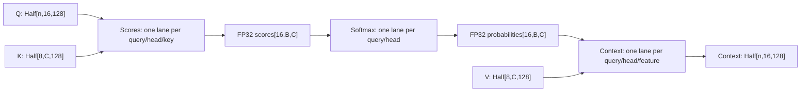

# Exact-order Reference attention scheduling

This is a bounded scheduling experiment for the approved
[Qwen3 native arithmetic profile](qwen3-native-profile.md). The existing Serial
implementation remains the default and oracle. The experimental path is explicit,
diagnostic-only, and restricted to the selected Qwen3-0.6B geometry, offset zero,
capacity at most 4096 and chunk32/128. It does not raise the app's512 limit or
qualify iPhone, other checkpoints or the model's full40960 window.

## Mechanism and ownership

[reference_schedule.rs](../src/metal/reference_schedule.rs) owns cold pipeline
initialization, dispatch validation and exact controls. The three kernels live in
[reference_schedule.metal](../src/metal/reference_schedule.metal). The existing
shader source and its pipeline list/launch width stay unchanged. Only explicit
experimental construction compiles the additional library. A model-owned
`OnceLock` caches its success or failure and three command labels; sessions borrow
the resulting pipelines. A failed optional initialization leaves Serial usable.

Weights remain immutable and shared. Each session owns its KV, scratch, token
history and distribution state. No new numerical buffer, expanded KV heads,
per-layer host wait or per-element backend lookup is introduced. The three ended
encoders share one command buffer and use tracked buffer dependencies.

With `n` current rows, chunk capacity `B`, cache capacity `C` and valid depth `V`:

The score lane retains the original serial feature loop and scaling. Softmax
retains the original causal maximum, exponential, serial key sum and division
order; future probabilities remain positive zero. Context retains the original
serial causal-key loop and checked Half rounding. GQA maps each adjacent pair of
query heads to one KV head. Scores/probabilities use capacity strides, while
logical rows and valid keys determine the dispatched work. Only independent
outputs move to different lanes. Actual bit identity still requires checks;
this reasoning alone grants no numerical qualification.

The public diagnostic constructor cannot grant its own model capability: it
requires the private flag produced by the validated Qwen3 context loader. The
test-only tiny geometry/injection remains inaccessible to that constructor.
The tiny test's offset case was corrected to keep chunk size within its reduced
capacity; production limits, fixtures, kernels and numerical gates did not change.

## Evidence and decision

The exact primitive/deep controls and tied/untied tiny-stage bridge pass. The
complete37376-token real-model replay matches all nine authenticated
[Serial4096 captures](qwen3-context4096.md), including every4096-row A/B/quality
hash set and all state/generation events. A strict historical-row binding captures
the full current row before rejecting any mismatch; the independent whole-journal
bridge remains mandatory.

The complete10000-target loss bridge also passes. The first task launch rejected
the grading payload before loading a model; a separate task-only continuation
uses the exact original `execution.jsonl` input. All100 tasks and5640 deterministic
events now match the historical run exactly. The failed attempt and accepted
loss/replay remain retained. Historical grades apply through identical outputs;
weak native3/100 versus BF165/100 absolute scores are unchanged.

Retention requires complete unchanged quality, repeated completed whole-model
deep-call and short-request measurements, three warmups and ten samples per
schedule, reverse-order confirmation, the original practical gain policy, bounded
memory and independent Astra review. Cached-tail measurements cannot establish
whole4096-prefill throughput. Raw short-request wall includes its bounded
exactness witnesses, with no overhead subtraction. The
[full-window plan](qwen3-full-window-plan.md) resumes after this decision.

## Retained result on Apple M1 Pro

Astra independently approves retention for this explicit diagnostic endpoint.
Two complete runs on MacBookPro18,3/M1 Pro/16GiB/macOS26.6.2 use opposite schedule
orders, three warmups and ten measured samples per schedule. All53016 prescribed
commits, paired/repeated distribution hashes and session states pass. Both runs
have nonoverlapping faster ranges for all four metrics and no regressions.

| Completed workload | Initial Serial / parallel median | Confirmation Serial / parallel median |
| --- | --- | --- |
| 32-row call after4064 cached tokens | 6.8801 / 1.2322s | 6.8830 / 1.2324s |
| One-row call after4095 cached tokens | 6.5856 / 0.1688s | 6.5735 / 0.1682s |
| Short128 whole request | 6.4636 / 2.3622s | 6.4711 / 2.3675s |
| Short480 whole request | 23.2943 / 6.4327s | 24.4209 / 6.4296s |

The minimum primary median reduction82.08996% exceeds both the original5%
practical gate and maximum between-run primary median variation0.04164%.
Short requests include the same witness copies and final flush; no instrumentation
overhead is subtracted. These cached-tail measurements do not measure whole4096
prefill throughput or an uninstrumented app.

Maximum lifetime physical footprint is1669318336 bytes, below6GiB. Immutable
weights are shared by the paired sessions; the independently recomputed joint
admission also includes both KV/scratch/history plans and256MiB application
reserve. All six owned workload processes/groups close. Hardware, OS and power
settings remain identical, with AC power,80% battery and AC low-power mode off.
All four raw thermal endpoints report no recorded thermal/performance warning;
these snapshots are not continuous temperature/frequency telemetry.

Formatting, strict default/Metal Clippy,372 default tests,249 Metal-library tests,
the targeted example/Python tests and explicit primitive/tiny-stage GPU controls
pass. Counts overlap. The final focused check authenticates the single example
change and reuses unchanged core controls; failed earlier check/task attempts and
their source/raw evidence remain retained. Publication independently reads raw
timings, recomputes summaries and authenticates614 bindings. It authenticates
existing numerical/quality bridges, without rerunning arithmetic or grading.

See the [machine-readable result](../benchmarks/results/2026-10-28-qwen3-reference-schedule-v1.json)
for all samples, medians, memory, parent identities and Astra's decision. Serial
remains the ordinary default and oracle; the explicit API remains experimental
outside this pinned model/device/4096 contract. App512,8192 qualification,
full40960 delivery and iPhone remain open.
