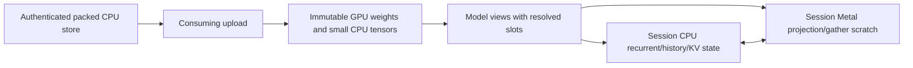

# Qwen3.5-4B Metal projection executor

Q1.G implements a concrete, statically dispatched projection/gather executor for
`avan-ag/Qwen3.5-4B-Uncensored-MLX-4bit` at revision
`fb98fbc59c71a567f3e23435386c9e93951261db`. Existing CPU normalization, convolution,
gated-delta recurrence, rotary, attention and state publication remain shared.
Activations and state remain FP32; original affine4/group64/BF16 GPU weights use
the qualified precise compensated projection. No Half substitution or CPU
projection fallback is introduced.

The consuming loader releases each original CPU matrix after uploading it;
ordinary GPU storage retains zero CPU matrix bytes. Small tensors retain their
exact BF16-to-FP32 CPU representation. Transient CPU/GPU/upload overlap, retained
buffers/guards, actual capacities and context/metadata/pipeline policies are
charged before publication. Session scratch includes the GPU executor and CPU
scratch; the embedded executor bodies count once in session metadata. Policies
are requested-ownership accounting, not measured physical residency. The 6 GiB
qualification also requires a measured process lifetime physical peak.

The existing whole-chunk transaction owns three recurrent/history banks and
separate per-layer K/V. Backend calls are monomorphized at operation boundaries;
there are no numerical-loop trait objects or tensor-name lookups. Completed
primitive Work counters advance only after a whole projection/gather succeeds;
partial commands inside a failed projection are not presented as completed
projections. Observer/cancel failures preserve the valid committed prefix.

A poisoned GPU workspace requires explicit repair. Reset clears numerical state
without repairing poison. Repair pre-admits simultaneous old/new execution
scratch and leaves committed state/published logits untouched on rejection.
The real-source fault occurs after two completed vocabulary-head chunks, after
all candidate recurrent and attention work. Repair and retry reproduce the
clean result bit for bit, including every logit from all 17 inputs.

The [frozen contract](../artifacts/qwen35-metal-executor-2026-11-08/acceptance-contract.json)
uses raw input 1 at offset 0 and 17 raw inputs at offset 37, capacity 512/chunk 32. Both
independent source-backed ideal FP64/staged FP32 datasets are unchanged. Full final
stage/state/logit comparisons pass 32,134,656 and 32,667,136 values respectively,
with max gate ratios 0.239/0.447 and matching greedy IDs. Tiny fixtures cover all
four workloads and 12 partition schedules: 3,675,072 comparisons, maximum ratio 0.153.
Partition/reset/retry bits, stale nonfinite KV masking and zero warmed Rust
forward/retry/reset allocations pass. Framework command allocation is outside
that Rust allocation claim. Actual-source physical peaks are 3.424/3.425 GB.

Required fmt/both strict all-target Clippy and 631 CPU/765 Metal tests pass
(39/313 ignored), as do native54 three arm64 slices/46 exports and CPU/Metal C
smokes. Nine context-reader/nine benchmark-reader tests and 20 coupled/six
performance damaged-evidence controls pass. The strict reader reconciles every source/model/session owner
against frozen arm64 ABI layout, validates raw physical peak and receipt/footer
agreement, and rejects scope/type/coverage/repair inconsistencies. Earlier
lifetime/alias compilation errors, context-key reader misuse and the benchmark
parity Clippy correction remain in evidence. The final binaries before/after
the parity correction are byte-identical; original capture pins stay unchanged.
Self-review found that deleting periodic environment observations could still
qualify a long run. Named commands, complete schemas and timeline coverage now
reject resealed deletion, missing late observations and out-of-run timestamps.
The declared 30-second observations permit at most 60 seconds between samples,
including endpoints. Original first-cohort evidence revalidates unchanged.

Both matched coupled-forward cohorts pass. Each fresh owned process has three
warmups and ten measurements per backend, alternating order and reversing the
first role between cohorts. Raw samples and dispersion remain in the
[strict report](../artifacts/qwen35-metal-executor-2026-11-08/performance-final.json).

| Cohort | Scalar median / MAD (s) | Metal projection + CPU state median / MAD (s) | Lower median | Process peak (GB) |
| --- | --- | --- | --- | --- |
| 0 | 138.027 / 0.296 | 3.315 / 0.327 | 97.598% | 5.306 |
| 1 | 138.017 / 0.210 | 3.097 / 0.138 | 97.756% | 5.307 |

All 17 full-logit pairwise comparisons pass with observed maximum error ratio
zero. Both environment timelines pass, complete lifetime peaks fit 6 GiB and
both owned groups are absent. Primary time is
completed 17-input/offset-37 forward caller walltime with resident weights and an
empty numerical prefix after reset. Reset/load/compare/diagnostic I/O stay outside
the timer; raw samples and external 30-second power/thermal/pressure observations are
retained. The comparison explicitly charges a separate original packed CPU
reference together with the candidate and diagnostics against 6 GiB. Scalar
reference trials take roughly 30 minutes per process. Light documentation,
metadata reads and offline reader checks occurred alongside collection, with
no competing model computation or builds; the
[activity record](../artifacts/qwen35-metal-executor-2026-11-08/auxiliary-activity.json)
preserves this limitation. Correctness capture timings are not performance samples.

Astra approves scoped coupled projection retention with no findings;
[checks/review/commit](../artifacts/qwen35-metal-executor-2026-11-08/publication-checks.json).
This does not qualify a whole-GPU graph, codec, managed request route,
TTFT, sustained performance, new instrumentation overhead, quality or adoption.
Next are admitted contexts, tokenizer/controller semantics and the same request
metrics/quality gates before managed selection or further optimization.
