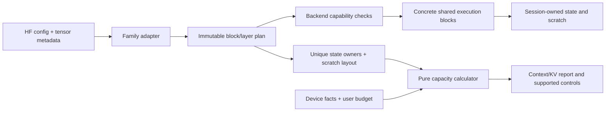

# Shared-block model support and capacity tuning

Active goal,28 October2026. This replaces the Qwen3 full40960-window execution
priority following the user's explicit change of requirements. Astra researched
the current code and primary upstream designs; a second Astra reviewed the
architecture and capacity boundaries. Existing qualification records retain
their original scope. The [interrupted8192 experiment](qwen3-context8192-experiment.md)
is preserved as experimental and is not a completed qualification.

## Deliverable

Run a broad set of Hugging Face MLX-format text models in native Rust by composing
shared blocks. For each artifact/backend/device, calculate its supported context
and physical state memory, then let the user choose implemented settings. Expand
architecture coverage before architecture-specific performance work.

“Any model” is the coverage direction. Unknown graph mechanisms, incompatible
packing, unavailable text protocols and models exceeding device memory must have
specific explanations. A model-family name or successful metadata parse does not
establish executable support. Context is shared input/history plus output tokens;
generation speed is a separate measured property.

## Existing foundation

| Component | What exists | Current gap |
| --- | --- | --- |
| Dense blocks | Shared Qwen2/Qwen3/Llama/Mistral and bounded Phi3 projections, RMS/QK norms, ordinary and Llama3 scaled split-half RoPE, GQA, causal attention and SiLU MLP | Llama structural admission and a bounded real checkpoint now pass; other config variants and device/artifact qualification remain scoped. A family name does not cover all its exports. |
| Packed weights | MLX affine primitives and validated floating/packed tensor layouts | Primitive format support is broader than whole-model/backend support. Other containers or quantization conventions are separate mechanisms. |
| Local/shared state | Concrete full/sliding producer caches and shared consumers, including existing Gemma work | Gemma is not an ordinary native Chat family; its open graph/precision gates remain. |
| Planning | Checked dense CPU/Metal session plans, shared/window accounting, native context facts and the completed B0 capacity solver | Broader per-model capability reporting and friendly context/KV controls remain. Each inspection still initializes device/pipelines once; capacity candidates use pure arithmetic. |
| Text and discovery | HF search/download foundations and four pinned text profiles | Numerical compatibility must not silently enable unknown chat templates or tokenizer/stop semantics. |

Use the existing implementations in `src/mlx`, `src/model/shared_kv.rs`,
`src/model/window_cache.rs`, `src/session.rs`, `src/metal/planning.rs` and
`src/native/context.rs`. A second unrelated execution framework is unnecessary.

## Architecture boundary

- **Family adapters:** validate mathematics-affecting config fields and resolve
  tensor names, shapes, packing and shared ownership once. Each new family wires
  existing blocks where they match; a genuinely new mechanism adds a tested
  block. No arbitrary remote model/template execution.
- **Shared blocks:** projection layout, attention, positional transform,
  normalization, residual order and feed-forward mechanism are explicit choices.
  Separate/fused QKV, standard/scaled RoPE, RMS/offset-gain normalization,
  SwiGLU/GeGLU and full/local attention are not interchangeable aliases.
- **Static execution:** ordinary functions, concrete types and bounded enums;
  choose kernels at operation/session boundaries. No dynamic dispatch per scalar,
  head or tile and no general graph interpreter. Add variants only with concrete
  implementations and fixtures.
- **Ownership:** immutable weights belong to the model. KV/recurrent state,
  scratch, history and command resources belong to the session. Shared consumers
  reference validated producers. Cache identity includes artifact, positions,
  rotary and precision semantics; changing them requires recreation/replay.
- **Independent text support:** tokenizer, chat template, hidden stops and
  decoding remain outside kernels. Report raw inference and Chat support
  separately; an unsupported template is not an unsupported numerical graph.

## Capacity and KV contract

Use the same physical allocation recipes as constructors. A family-name formula
or parameter-count estimate cannot replace them. Count tied/shared storage once
by validated owner identity. For an ordinary full KV owner, payload is:

`capacity × kv_heads × (key_dim + value_dim) × bytes_per_element`

Sum unique owners, then add actual guards, strides, padding and update/staging
overlap. Existing local caches use their implemented retention and staging rules.
Do not universally substitute `min(context, window)`. MLA and recurrent state
need their own implemented layouts; until then, report an unsupported mechanism
rather than manufacture a dense-KV estimate.

Also account for resident weights, scratch, score matrices, logits, history,
loading/conversion peaks, tokenizer, text/UI/persistence and runtime allowances.
Use the maximum of separately accounted phases, respecting real overlaps.
Reference attention's two score buffers depend on both chunk and context; KV
bytes alone do not determine whether a request fits.

Resolve metadata and backend/device layout facts once. A pure checked solver
finds the largest capacity satisfying total budget and every buffer limit. Use
bounded binary search only for proven monotone allocation recipes, with exact
selected/selected+1 checks. Do not search by allocating until OOM or repeatedly
compiling pipelines. Factory admission runs again against fresh facts before
allocation; a prediction is not a reservation.

Keep these facts distinct in the report:

1. Model-declared positions and required blocks/representation.
2. Backend implementation range and supported modes.
3. Device/budget-fit range and selected-plan byte breakdown.
4. Actual numerical validation scope, if known.
5. Additional application input/output/text limits.

Unsupported architecture, unsupported packing, supported-but-too-large and
compatible-but-untested are different outcomes. An interrupted experiment never
upgrades validation. Preserve the6GiB initial ceiling and existing device policy;
lower user budgets are additional constraints. Mac and iPhone admission remain
separate. Unified CPU/GPU memory is one budget.

## Execution order and acceptance

**B0 complete:** the [shared capacity core](capacity-core.md) passes its checked
allocation/search boundaries, standard checks, three tiny GPU controls and
independent Astra review. B1 is next. This does not add a model family, user
control or a larger qualified context by itself.

**B1 complete in its selected Mac512 engine-adapter scope:** the
[scalar positional core](llama3-rotary-core.md), [source/model plan](llama3-position-plan.md),
[isolated rotary](llama3-metal-rotary.md), [structural composition](llama3-metal-composition.md)
and [index contracts](metal-index-contracts.md) pass. The pinned real Llama3.2 1B
[short vertical/text contract](llama3-real-model-contract.md) and unchanged
[1,024-target consistency screen](llama3-loss1024.md) pass source/native, cache,
raw generation and measured-memory requirements. This does not qualify declared
131072, original unquantized10k/100 adoption quality, production Chat or iPhone.
Those remain B5/M8 closure work. Next is B2 fused-row composition; frontend
qualification does not interrupt the breadth-first order.

**B2 complete in its selected Mac512 adapter scope:** checked original row spans and
one [cold logical loading plan](logical-projection-loading.md) now compose the
strict ordinary Phi3 adapter with existing dense blocks. The independent
[head96 CPU/Metal checks](phi3-dense-composition.md) pass at the initial512 bound,
retaining declared4096/window2047. The [real Phi3 vertical](phi3-real-model.md)
also passes23,946,432 comparisons, source/native/session/text and measured-memory
checks. No whole-family, app, full-window or original adoption-quality claim.

**B3 complete in its selected Mac544 native conformance scope:** the
[real Gemma3 vertical](gemma3-real-native.md) passes the prospectively frozen
actual-input/coupled policy after fresh native collection and independent
checking/review. All18,537,288 selected values retain fatal coverage. Earlier
92/84 CPU-trajectory screens remain rejected. Original-unquantized10k/100 quality,
ordinary app/Chat, declared full window and iPhone stay separate B5/M8 work.
B4a's strict LFM2 cold plan and B4b's standalone scalar history are complete.
See the [cold report](lfm2-cold-plan.md) and [history report](short-conv3-history.md).
B4c's [independent tiny scalar hybrid](lfm2-scalar-hybrid.md) now passes. Next is
B4d's resident leaf/composition qualification; real runtime admission remains
pending through B4d–e.

| Task | Concrete delivery | Required checks |
| --- | --- | --- |
| **B0: shared planning core** | Reuse checked physical KV-owner descriptors in dense CPU/Metal and existing window/shared plans. Add a pure capacity solver; resolve Metal layouts once. Preserve current caps, eligibility, arithmetic and defaults. Keep this small: no new settings panel or graph VM. | Exact old allocation totals; distinct F16/F32 and shared-owner accounting; local retention/staging; overflow, per-buffer, budget and selected+1 boundaries; planner/constructor equality. Ordinary checks and relevant tiny controls. |
| **B1: Llama3 scaled RoPE** | Add a reusable scaled positional block and a small Llama3-style adapter/model vertical using existing dense attention/MLP/session blocks. Pin a device-fitting artifact/config/packing/text protocol first. | Independent transition-frequency/high-offset fixtures, unchanged old outputs, short complete source/native/cache comparisons, bounded real generation and actual memory. No maximum-window ladder prerequisite. |
| **B2: fused projection composition** | Add a compact Phi-style candidate with checked fused QKV/gate-up mapping. Reuse projection kernels before pursuing fusion speed. Implement its actual positional semantics. | Packed row-span/alignment fixtures, tiny composed graph, short real source/native/session and text checks. No ignored LongRoPE or unsupported-field fallback. |
| **B3: local/global composition** | A compact Gemma text candidate, reusing existing local/shared mechanisms where identical. Keep different Gemma generations explicit. | Norm/residual/activation/rotary fixtures, a meaningful cache-wrap boundary, representative graph/generation and resource checks. Follow the [bounded native conformance policy](gemma3-native-conformance.md) for selected Gemma3 actual-input semantics and strict coupled attention/output checks; historical fidelity rejections remain. Existing Gemma diagnostics do not grant ordinary support or waive B5/M8 adoption quality. |
| **B4: additional mechanisms** | First add the [LFM2 short-convolution state block](lfm2-hybrid-plan.md) with shared full-attention layers through B4a–e. Further MoE/MLA admissions remain separate concrete tasks. | Exact state/update/rollback fixtures, complete ownership accounting and a fitting real representative before a family claim. Metadata/planning fit is not model qualification. Active experts are not total resident weights. |
| **B5: user controls and HF integration** | Expose supported context, reply limit, budget and advanced chunk/KV-byte ceilings through the same report; persist settings by artifact identity and plan schema. Reuse existing app surfaces. | Atomic apply/recreation, rejected-setting preservation, stale-model/report handling, actual encoded prompt+reply boundary, supported download/load/offline journey and whole-app memory. |
| **M9: next performance milestone** | Follow the [performance delivery contract](next-performance-milestone.md): P0 profiling, one selected P1 candidate, then P2 adoption/rejection. Preserve its extension boundaries during M8. | Unchanged correctness/quality gates, representative repeated measurements, memory effects and a retain/revert decision. Later techniques remain conditional. |

B1 follows the small B0 core immediately. Frontend knobs must not delay actual
architecture breadth. B4 is a sequence of concrete admissions, not a speculative
requirement to build every possible architecture before useful controls ship.

The user's [next performance plan](https://chatgpt.com/space/page_18e155f0450c8191a76010b2b26832a5)
is M9, after this M8 queue. Its [architecture mapping](next-performance-milestone.md#architecture-obligations-during-m8)
separates model semantics from norm/projection/attention scheduling, physical
cache codecs, transaction support and requested outputs. Add those seams with
real consumers; avoid unused optimization variants during architecture work.

Initially offer only implemented options: context, response limit, memory budget
and supported chunk choices. Metal KV is currently F16 and scalar KV F32; show
those facts. A selectable KV quantization type requires an implemented codec,
kernel, accounting and validation first. Weight quantization comes from the
artifact and is a different setting. Never silently truncate full attention,
shrink a model's local window or extrapolate RoPE as a memory-saving toggle.

Each code task ends with targeted checks, Astra review, an improvement-record
update and a commit. Freeze independent numerical criteria before new block
runs. Reuse checks for unchanged mechanisms; do not repeat the old full-context
campaign merely because a family name differs. Full-window Qwen3, old streaming
prototypes and iPhone work remain preserved but are not this queue's prerequisite.

## Research references

Astra inspected these primary implementations for design patterns. This plan
imports no upstream code. Pin an immutable revision before deriving fixtures or
adapting an implementation.

- [vLLM Llama composition](https://github.com/vllm-project/vllm/blob/main/vllm/model_executor/models/llama.py)
  separates model wiring from shared linear, norm, activation, rotary and
  attention components.
- [vLLM KV specifications](https://github.com/vllm-project/vllm/blob/main/vllm/v1/kv_cache_interface.py)
  distinguish full/local and other state layouts instead of assigning identical
  KV storage to every layer.
- [llama.cpp Llama builder](https://github.com/ggml-org/llama.cpp/blob/master/src/models/llama.cpp)
  and [its user controls](https://github.com/ggml-org/llama.cpp/blob/master/tools/server/README.md)
  separate model loading/graph construction from backend operations and request
  context/storage settings.
- [MLX-LM Llama](https://github.com/ml-explore/mlx-lm/blob/main/mlx_lm/models/llama.py),
  [RoPE variants](https://github.com/ml-explore/mlx-lm/blob/main/mlx_lm/models/rope_utils.py)
  and [cache construction](https://github.com/ml-explore/mlx-lm/blob/main/mlx_lm/models/cache.py)
  provide small model compositions and model-selected state semantics.
